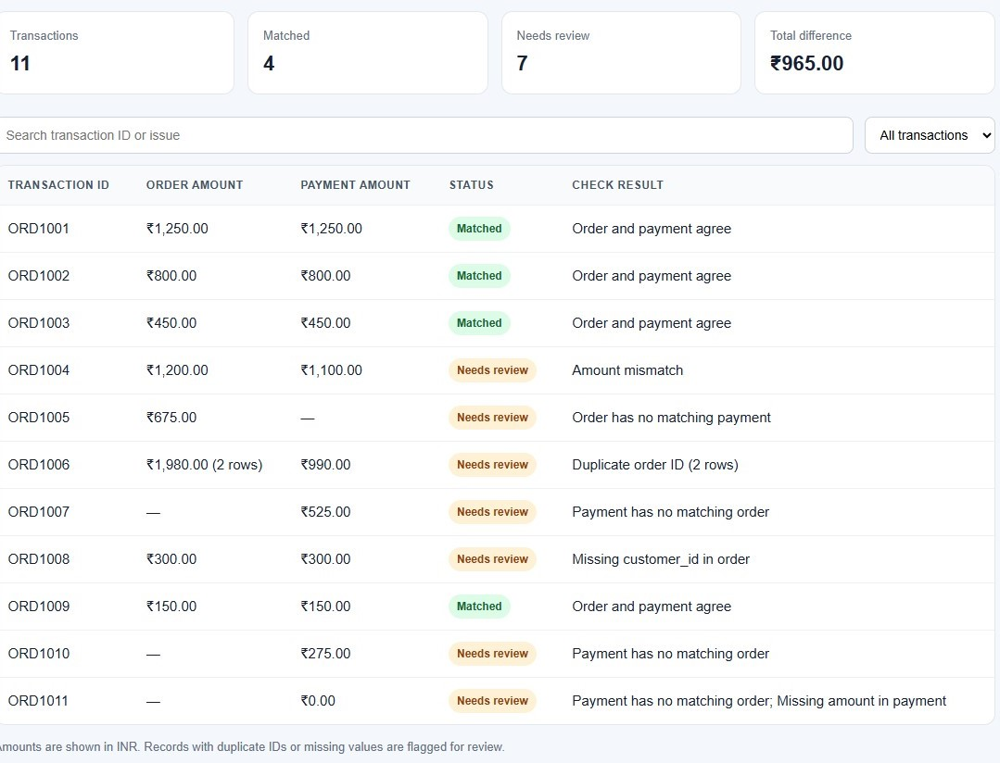

# Data Quality and Reconciliation Workbench

An order-to-payment reconciliation workbench using Python and PostgreSQL to check transaction data, flag exceptions, and generate a searchable review report.

## What it checks

- Required fields that are blank
- Duplicate transaction IDs in either file
- Orders with no payment record
- Payments with no matching order
- Amount differences for IDs that occur exactly once in both files
- Total amount difference between the two files

The included records are synthetic practice data. No real customer or payment information is used.

## Run it

You need Python 3. Open a terminal in this project folder and run:

```bash
python src/reconcile.py
```

The script prints a summary and creates three reports in `reports/`:

- `reconciliation.html` — a readable, filterable view of every transaction. Open it in a web browser.
- `exceptions.csv` — exception rows for Excel or further analysis.
- `summary.json` — machine-readable totals and exception counts.

## Project files

- `data/orders.csv` — transactions from a sample order system
- `data/payments.csv` — transactions from a sample payment system
- `src/reconcile.py` — reconciliation and data quality checks
- `sql/01_create_tables.sql` — PostgreSQL table definitions
- `sql/02_quality_checks.sql` — SQL checks for duplicates, unmatched records, amount mismatches, and missing fields
- `reports/` — generated results

## Current scope

The Python version uses built-in libraries and CSV files, so it runs locally without installing packages. IDs that are duplicated are reported as exceptions and excluded from amount comparison because the correct matching row is ambiguous. The HTML report provides a searchable, filterable transaction view.

## PostgreSQL checks

The `sql` folder contains PostgreSQL versions of the main checks. Run `01_create_tables.sql` in pgAdmin, import `data/orders.csv` into the `orders` table and `data/payments.csv` into the `payments` table, then run the queries in `02_quality_checks.sql`. The Python report can be used without PostgreSQL.

## Report preview



Understanding the total difference
The ₹965 shown is the difference between the total valid order amounts and payment amounts in the source files. It includes unmatched and duplicate records; the specific amount mismatch is ORD1004, where the order is ₹1,200 and the payment is ₹1,100, a difference of ₹100.
AI-assisted development
I used OpenAI Codex and ChatGPT for project guidance, debugging, and documentation. I ran the Python workflow locally and validated the PostgreSQL checks in pgAdmin.

